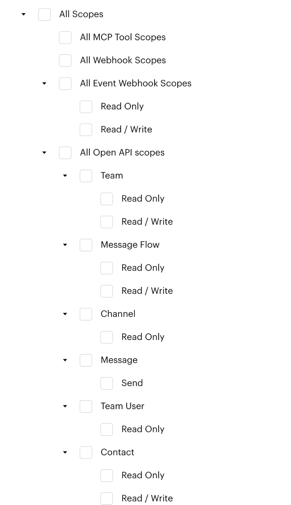

# Open API

## What is the Open API?

The Luluchat Open API lets your own systems read data from your Luluchat workspace. For example, you can list your channels, check your team details, or look up the message flows you can trigger with a [Webhook Trigger](webhook-trigger.md).

Full request and response examples are in our [Postman documentation](https://documenter.getpostman.com/view/985588/2s9YJW4RAc).


**Base URL**

```
https://open-api.luluchat.io/v1/
```

Every request must use HTTPS and include your access token.


## Prerequisites

* A Luluchat account with access to `Settings` > `Account` > `Integration`
* An **access token** with the right scopes (see below)

## Step 1: Create an access token



#### Open the Access Token section

Go to `Settings` > `Account` > [**Integration**](https://app.luluchat.io/settings?view=integration) and scroll to **Access Token**.



#### Click Create Access Token

Fill in the form:

* **Name**: Where the token is used, e.g. `CRM sync`
* **Expiry**: 1, 3, 6 or 12 months, or **Never**
* **Scopes**: Tick the scopes for the endpoints you need. See [Choosing scopes](#choosing-scopes).



#### Copy the token

Click **Submit**. Copy the token from the **Access Token Created Successfully** window and store it somewhere safe.


The token is **only shown once**. If you lose it, delete it and create a new one.




### Choosing scopes

A token can only call the endpoints its scopes allow. Tick these options in the **Scopes** list:

<figure><figcaption><p>Open API scopes</p></figcaption></figure>

| To use | Tick | Scope created |
| --- | --- | --- |
| [Get Team Profile](#get-team-profile) | **All Open API scopes** > **Team** | `api:team:*` |
| [List Message Flows](#list-message-flows) | **All Open API scopes** > **Message Flow** | `api:flow:*` |
| [List Channels](#list-channels) | **All Open API scopes** > **Channel** | `api:channel:*` |
| [List Team Members](#list-team-members) | **All Open API scopes** > **Team User** | `api:user:*` |
| [Get Contact](#get-contact) | **All Open API scopes** > **Contact** > **Read Only** | `api:contact:read` |
| [Assign a Contact](#assign-a-contact) / [Unassign a Contact](#unassign-a-contact) | **All Open API scopes** > **Contact** > **Read / Write** | `api:contact:write` |
| [Event Webhooks](event-webhooks.md) | **All Event Webhook Scopes** | `api:event-webhook:*` |


**Tick the group, not only "Read / Write".** A scope only allows what it names: **Read / Write** (`...:write`) lets you register and remove event webhooks, but **not** list them, which needs **Read Only** (`...:read`). Ticking the group (e.g. **All Event Webhook Scopes**) includes both.


## Step 2: Call the API

Send the token in the `Authorization` header of every request:

```
Authorization: Bearer YOUR_ACCESS_TOKEN
Accept: application/json
Content-Type: application/json
```

**Example: check that your token works**

```bash
curl https://open-api.luluchat.io/v1/teams/me \
  -H "Authorization: Bearer YOUR_ACCESS_TOKEN" \
  -H "Accept: application/json"
```

## Response format

Every response is JSON with the same wrapper:

```json
{
  "status": true,
  "message": "OK",
  "data": { },
  "http_status": 200
}
```

* `status` is `true` when the request succeeded.
* List endpoints also return `meta` with `page`, `pages`, `perpage` and `total`.

## Endpoints

| Method | Path | Scope | Description |
| --- | --- | --- | --- |
| `GET` | `/teams/me` | `api:team:read` | Get your team profile |
| `GET` | `/channels` | `api:channel:read` | List your channels |
| `GET` | `/automation-flows` | `api:flow:read` | List your message flows |
| `GET` | `/teams/members` | `api:user:read` | List your team members (who a contact can be assigned to) |
| `GET` | `/teams/members/{id}` | `api:user:read` | Get one team member |
| `GET` | `/contacts/{id}` | `api:contact:read` | Get a contact, including its assignee |
| `PUT` | `/contacts/{id}/assignee` | `api:contact:write` | Assign a contact to a team member |
| `DELETE` | `/contacts/{id}/assignee` | `api:contact:write` | Remove a contact's assignee |

Want Luluchat to notify your system when a contact changes? The Event Webhook endpoints use the same base URL and access token, and are documented in [Event Webhooks](event-webhooks.md).


### Get Team Profile

`GET /teams/me`

Returns the team (workspace) that owns the token. Useful to test your token.

```json
{
  "status": true,
  "message": "OK",
  "data": {
    "uuid": "0b6c6f0e-5a0e-4d7f-9a41-6a2f1f0d8c11",
    "name": "Kopi Corner",
    "status": "active",
    "meta": {
      "created": "2025-01-15T03:18:42.000000Z",
      "updated": "2026-09-20T08:45:03.000000Z"
    }
  },
  "http_status": 200
}
```

### List Channels

`GET /channels`

Lists your team's channels (deleted channels are not included). Use a channel's `uuid` as the `channel_id` when you [register an event webhook](event-webhooks.md) for one channel only.

| Query parameter | Description |
| --- | --- |
| `page` | Page number |
| `perpage` | Results per page (default 50), or `all` |
| `status` | Filter by status, e.g. `ready` |
| `name` | Filter by channel name |

```json
{
  "status": true,
  "message": "OK",
  "data": [
    {
      "uuid": "3f6c2a1e-8b7d-4c5e-9a10-2b3c4d5e6f70",
      "name": "Sales WhatsApp",
      "contact_number": "60123456789",
      "status": "ready",
      "type": "whatsapp",
      "is_instantiated": true,
      "meta": {
        "instantiated": "2026-01-15T03:20:11.000000Z",
        "created": "2026-01-15T03:18:42.000000Z",
        "updated": "2026-09-20T08:45:03.000000Z"
      }
    }
  ],
  "meta": { "page": 1, "pages": 1, "perpage": 50, "total": 1 },
  "http_status": 200
}
```

### List Message Flows

`GET /automation-flows`

Lists your message flows and flow templates, with the channel each belongs to. Use a flow's `uuid` with the [Webhook Trigger](webhook-trigger.md).

| Query parameter | Description |
| --- | --- |
| `status` | Filter by status, e.g. `active` |
| `page` | Page number |
| `perpage` | Results per page, or `all` |

```bash
curl "https://open-api.luluchat.io/v1/automation-flows?status=active" \
  -H "Authorization: Bearer YOUR_ACCESS_TOKEN" \
  -H "Accept: application/json"
```

### List Team Members

`GET /teams/members`

Lists the members of your team so your system knows who a contact can be assigned to. Use a member's `id` as the `user_id` when you [assign a contact](#assign-a-contact). The list is not paginated.

| Query parameter | Description |
| --- | --- |
| `channel` | A channel `uuid` (see [List Channels](#list-channels)): only return members who can access that channel |

```json
{
  "status": true,
  "message": "OK",
  "data": [
    {
      "id": 42,
      "name": "Aisyah Rahman",
      "email": "aisyah@kopicorner.my",
      "phone": "+60123456789",
      "role": "agent",
      "channels": ["3f6c2a1e-8b7d-4c5e-9a10-2b3c4d5e6f70"]
    }
  ],
  "http_status": 200
}
```

`GET /teams/members/{id}` returns one member in the same shape.


`channels` lists the channel `uuid`s the member can access. A member can only be assigned contacts in those channels.


### Get Contact

`GET /contacts/{id}`

Returns one contact with its channel, assignee, collaborators, tags, lists and custom attributes. The `id` is the `contact_id` Luluchat includes in the messages it sends to your system.

```json
{
  "status": true,
  "message": "OK",
  "data": {
    "id": 1024,
    "name": "Daniel Lim",
    "push_name": "Daniel",
    "display_name": null,
    "type": "whatsapp",
    "iso_contact_number": "+60198765432",
    "remarks": null,
    "is_unsubscribed": false,
    "is_ai_handling": false,
    "channel": {
      "uuid": "3f6c2a1e-8b7d-4c5e-9a10-2b3c4d5e6f70",
      "name": "Sales WhatsApp",
      "contact_number": "60123456789",
      "status": "ready",
      "type": "whatsapp",
      "is_instantiated": true,
      "meta": {
        "instantiated": "2026-01-15T03:20:11.000000Z",
        "created": "2026-01-15T03:18:42.000000Z",
        "updated": "2026-09-20T08:45:03.000000Z"
      }
    },
    "assignee": { "id": 42, "fullname": "Aisyah Rahman" },
    "collaborators": [],
    "tags": [],
    "list": [],
    "attributes": [],
    "meta": {
      "created": "2026-03-02T07:11:09.000000Z",
      "updated": "2026-10-28T04:43:44.000000Z"
    }
  },
  "http_status": 200
}
```

### Assign a Contact

`PUT /contacts/{id}/assignee`

Assigns the contact to a team member. It works like assigning in the Inbox: the activity log, chat event, notification, message flows and the `contact.updated` [event webhook](event-webhooks.md) all follow.

| Body field | Description |
| --- | --- |
| `user_id` | Required. A member `id` from [List Team Members](#list-team-members). The member must have access to the contact's channel. |
| `requested_by` | Optional. Who made the change in your system (up to 100 characters). Shown in the contact's activity log. |

```bash
curl -X PUT "https://open-api.luluchat.io/v1/contacts/1024/assignee" \
  -H "Authorization: Bearer YOUR_ACCESS_TOKEN" \
  -H "Content-Type: application/json" \
  -H "Idempotency-Key: assign-1024-20261028-001" \
  -d '{"user_id": 42, "requested_by": "Middleware user 7"}'
```

Returns the updated contact in the same shape as [Get Contact](#get-contact). Assigning a contact to the member it already has is a no-op and still returns the contact.

### Unassign a Contact

`DELETE /contacts/{id}/assignee`

Removes the contact's assignee. The body takes an optional `requested_by`, as above. Returns the updated contact with `"assignee": null`.


**Retrying safely.** Send an `Idempotency-Key` header (any printable string up to 255 characters, unique per request) with assign and unassign calls. A retry with the same key and body returns the first response instead of applying the change twice, and is marked with an `Idempotent-Replayed` header. The same key with a different body is rejected. Keys are remembered for 24 hours.


## Errors

| Message | What it means | How to fix it |
| --- | --- | --- |
| `Invalid Access Token` | The token is missing, wrong, expired or deleted | Check the `Authorization: Bearer ...` header, or create a new token |
| `Invalid Scope` | The token doesn't have the scope this endpoint needs | Create a token with the right scope. See [Choosing scopes](#choosing-scopes). |
| `Channel not found.` | The `channel_id` doesn't belong to your team | Get the correct `uuid` from [List Channels](#list-channels) |
| `Record not found.` on `/contacts/{id}` | The contact `id` doesn't belong to your team | Use the `contact_id` Luluchat sent you, from the same team the token belongs to |
| `Invalid assignee` | The `user_id` is not a member of your team | Pick an `id` from [List Team Members](#list-team-members) |
| `Assignee has no access to this contact's channel` | The member can't see the contact's channel | Pick a member whose `channels` includes the contact's channel |


**Old API keys no longer work.** Authenticating with the team API key was deprecated on 31 March 2026. Use an access token instead. `Invalid API Key` means the token wasn't recognised at all: check you created it in the same Luluchat environment you're calling, and that it hasn't been deleted.


## Best practice 💡

* **One token per integration**: Create a separate token for each system so you can revoke one without breaking the others.
* **Least privilege**: Only tick the scopes the integration needs.
* **Keep tokens secret**: Store tokens in environment variables or a secrets manager. Never put them in front-end code or a code repository.
* **Watch Last Used**: The Access Token table shows when each token was last used. Delete tokens that are no longer needed.
