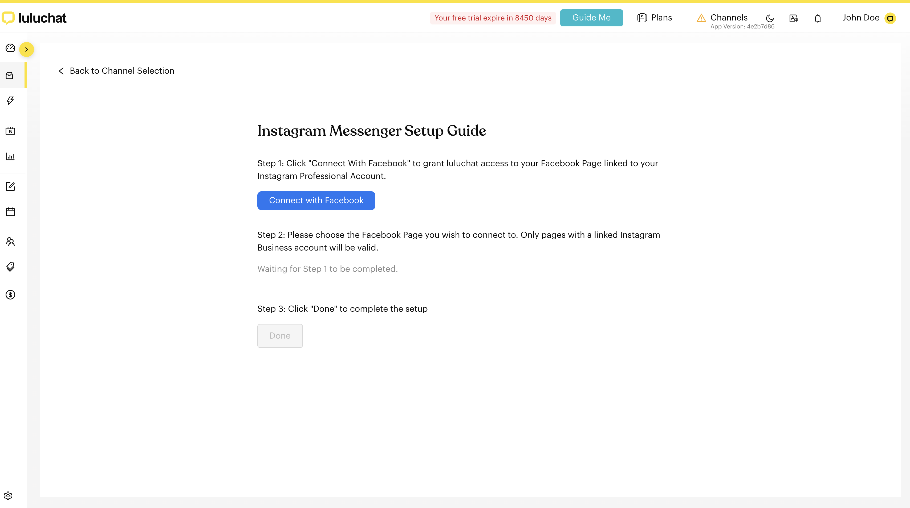
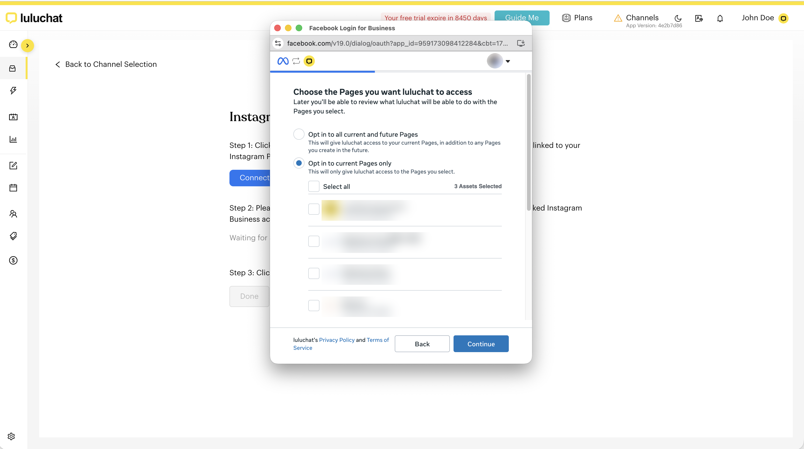
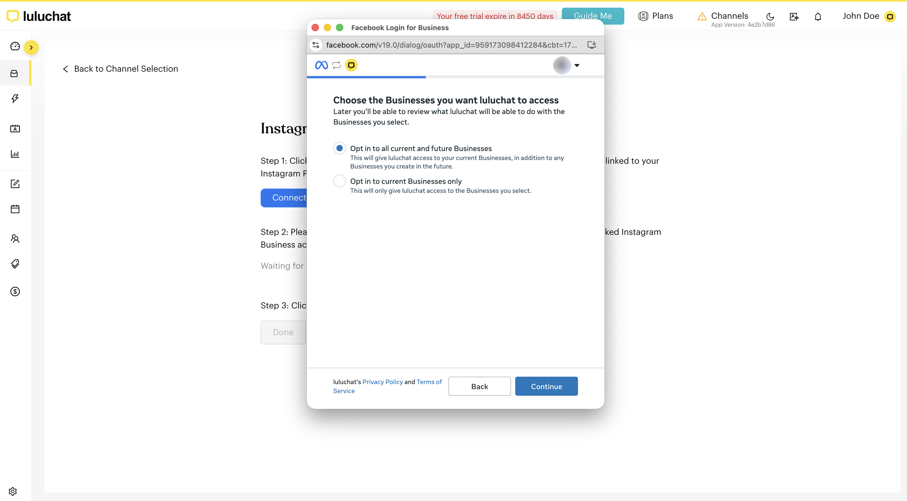
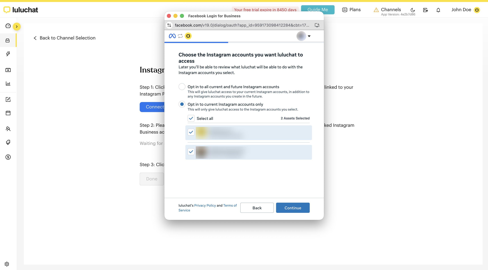
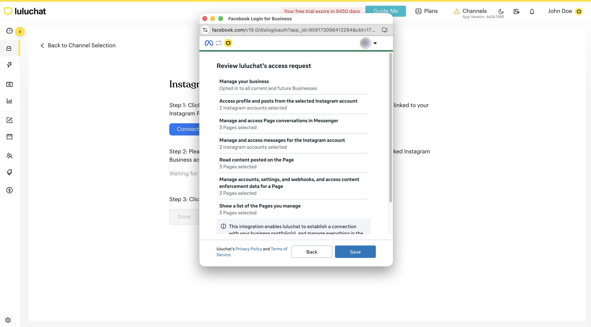
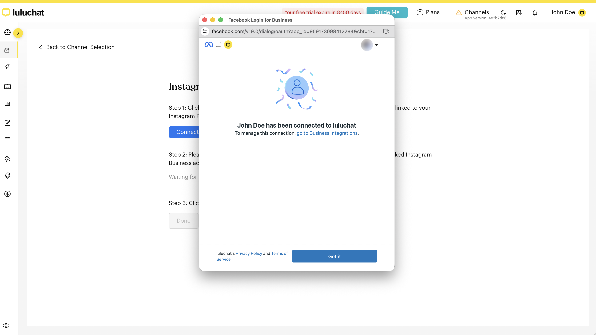
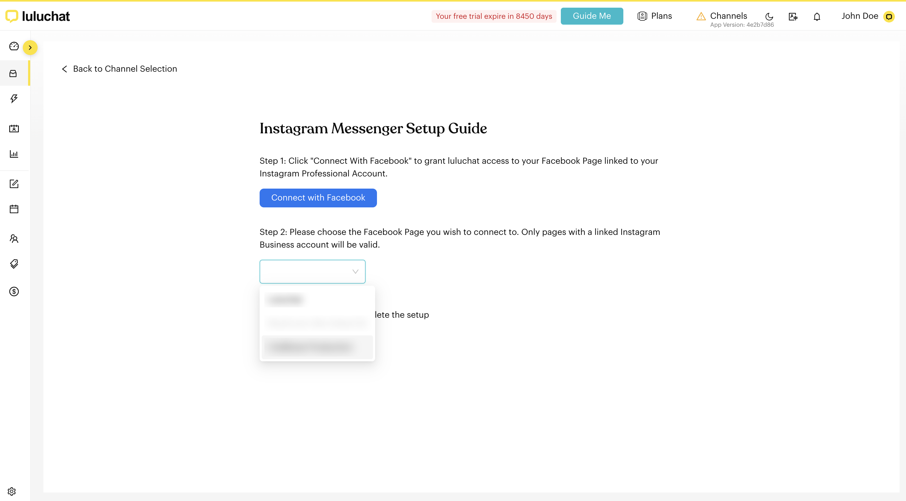
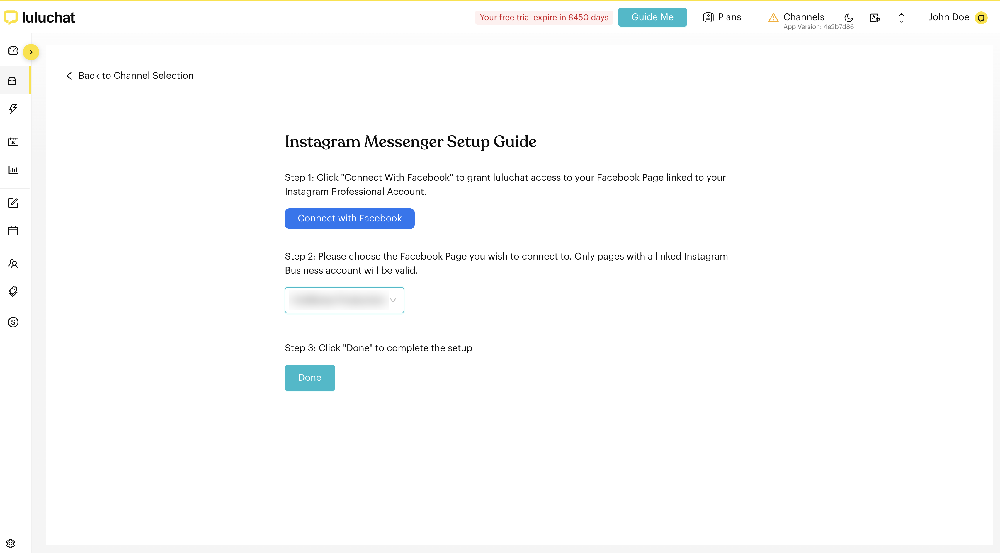
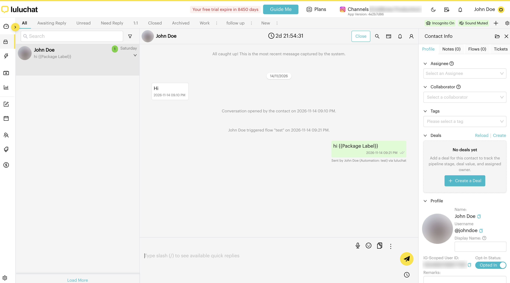

# Instagram Messenger

## What is Instagram Messenger connection?

Connecting an **Instagram Messenger** channel links your Instagram Professional account to Luluchat, so Instagram Direct Messages (DMs) arrive in your `Inbox`. You can reply to customers, assign chats to teammates and run Message Flows from the same place as your other channels.

Luluchat connects to Instagram through the **Facebook Page** that your Instagram account is linked to. Before you start, make sure that:

* Your Instagram account is a **Professional** account (Business or Creator).
* The Instagram account is **linked to a Facebook Page**.
* You can log in to Facebook as someone who manages that Page.


Not sure if your Instagram account is linked to a Page? In the Instagram app, go to your profile and open **Edit profile**. Under **Public business information**, check that **Page** shows your Facebook Page.


## When does it trigger?

* When you open `Inbox`, your current channel is not connected, and you choose **Instagram Messenger** on the **Connect your Channel** page.
* When an existing Instagram channel is disconnected and needs to be connected again.

## How to set it up (Step by Step)



#### Open Inbox and choose Instagram Messenger

1. Click `Inbox` in the left menu.
2. If the current channel is not connected, you will see the **Connect your Channel** page. (To connect another account, first add a new channel from the **Channels** button at the top right, then switch to it.)
3. Click **Instagram Messenger**.

The **Instagram Messenger Setup Guide** opens with three steps. Until you finish Step 1, Step 2 shows "Waiting for Step 1 to be completed." and the **Done** button is greyed out.

<figure><figcaption>
Instagram Messenger Setup Guide
</figcaption></figure>


If this channel was last connected with a different channel type (for example, WhatsApp Personal), Luluchat will ask you to confirm **Switch Channel Type** first. Continuing deletes the channel's existing contacts and past messages. See [Connect your Channel](connect-channel.md).




#### Step 1: Connect with Facebook

Click **Connect with Facebook**. A **Facebook Login for Business** window opens. Log in with the Facebook account that manages your Page, then go through Meta's screens:

1. **Choose the Pages you want luluchat to access**: Select the Facebook Page that is linked to your Instagram account, then click **Continue**.

   <figure><figcaption>
Choose your Facebook Page
</figcaption></figure>
2. **Choose the Businesses you want luluchat to access**: Choose your business, then click **Continue**.

   <figure><figcaption>
Choose your business
</figcaption></figure>
3. **Choose the Instagram accounts you want luluchat to access**: Tick the Instagram account you want to connect, then click **Continue**.

   <figure><figcaption>
Choose your Instagram account
</figcaption></figure>
4. **Review luluchat's access request**: Check the permissions, then click **Save**.

   <figure><figcaption>
Review the access request
</figcaption></figure>
5. When you see **"... has been connected to luluchat"**, click **Got it**. The window closes.

   <figure><figcaption>
Facebook confirms the connection
</figcaption></figure>

If you close the window or don't grant all the access, Luluchat shows "User cancelled login or did not fully authorize." Click **Connect with Facebook** again to retry.



#### Step 2: Choose the Facebook Page

1. After Step 1, Luluchat loads the Facebook Pages you shared.
2. Open the drop-down and pick the Page that is linked to your Instagram account.

Pages without a linked Instagram Professional account are greyed out and marked **(No linked IG)**. You can't select them.

<figure><figcaption>
Step 2: choose the Facebook Page
</figcaption></figure>



#### Step 3: Click Done

1. Click **Done**. (The button becomes active after you select a Page.)
2. When the connection succeeds, Luluchat shows "Channel connected." and the page refreshes into your Inbox.

If the connection fails, you will see "Failed to register." followed by the reason.

<figure><figcaption>
Step 3: click Done
</figcaption></figure>



## What happens after it triggers?

Once the Instagram channel is connected:

* New Instagram DMs sent to your account appear in `Inbox`. The **Channels** button at the top right shows the Instagram icon and the channel name.
* Each contact's **Contact Info** shows their name, Instagram username and **IG-Scoped User ID**.
* You can reply from Luluchat, assign chats, add tags and notes, and run Message Flows on the channel.
* In the **Channels** window, the channel shows **Channel Type: Instagram Messenger** and the connected Instagram account.

<figure><figcaption>
Instagram conversations in the Inbox
</figcaption></figure>

## Important behavior to know


**Important behavior to know**

* **Messaging window**: Meta only lets businesses message a customer for a limited time after the customer's last message:
  * **First 24 hours**: You can send anything, including automated flow and bot messages.
  * **From 24 hours to 7 days**: Only a real person may reply, to follow up on what the customer asked. Automated and promotional messages aren't allowed.
  * **After 7 days**: Nothing can be sent until the customer writes again. Instagram has no message templates.
* **Customers start the chat**: You can't start a new Instagram conversation from Luluchat. The customer must message your Instagram account first.
* **One channel, one Instagram account**: Each channel connects one Facebook Page and its linked Instagram account. To connect another account, add a new channel.
* **Channel Limits**: Your subscription plan controls how many channels you can connect. Contact support if you need more.
* **Disconnecting**: Open **Channels** (top right) and click **Disconnect** on the channel. Tick **Remove chat history** if you also want to delete chat history, then click **Yes, proceed**.


## Common issues & solutions

* **"User cancelled login or did not fully authorize."**:
  * The Facebook window was closed or not all access was granted. Click **Connect with Facebook** again and complete every screen.
* **Step 2 still says "Waiting for Step 1 to be completed."**:
  * Step 1 didn't finish. Click **Connect with Facebook** again.
* **My Page is greyed out with "(No linked IG)"**:
  * The Page has no linked Instagram Professional account. Link your Instagram account to the Page (in the Instagram app or Meta Business Suite), then click **Connect with Facebook** again.
  * Make sure your Instagram account is a Business or Creator account, not a personal account.
* **My Page or Instagram account is missing**:
  * In the Facebook window, you may have left it unticked. Click **Connect with Facebook** again and select it on the Pages and Instagram accounts screens.
  * Make sure your Facebook account has access to manage that Page.
* **"Failed to register."**:
  * Read the reason shown after the message, fix it, and click **Done** again.
* **Messages not arriving**:
  * In the Instagram app, go to **Settings** > **Messages and story replies** > **Message controls** and make sure **Allow access to messages** under **Connected tools** is turned on.

## Best practice 💡


**Best practice (Instagram Messenger)**

* Reply within 24 hours so your automations and bots can still send messages.
* Give the channel a clear name (for example, "Instagram – Kopi Corner") so your team knows which account it is.
* Only share the Pages and Instagram accounts you need in the Facebook window.


## Related Documentation

* [Connect your Channel](connect-channel.md)
* [Meta Messenger](connect-messenger.md)
* [Send Messages](send-messages.md)
