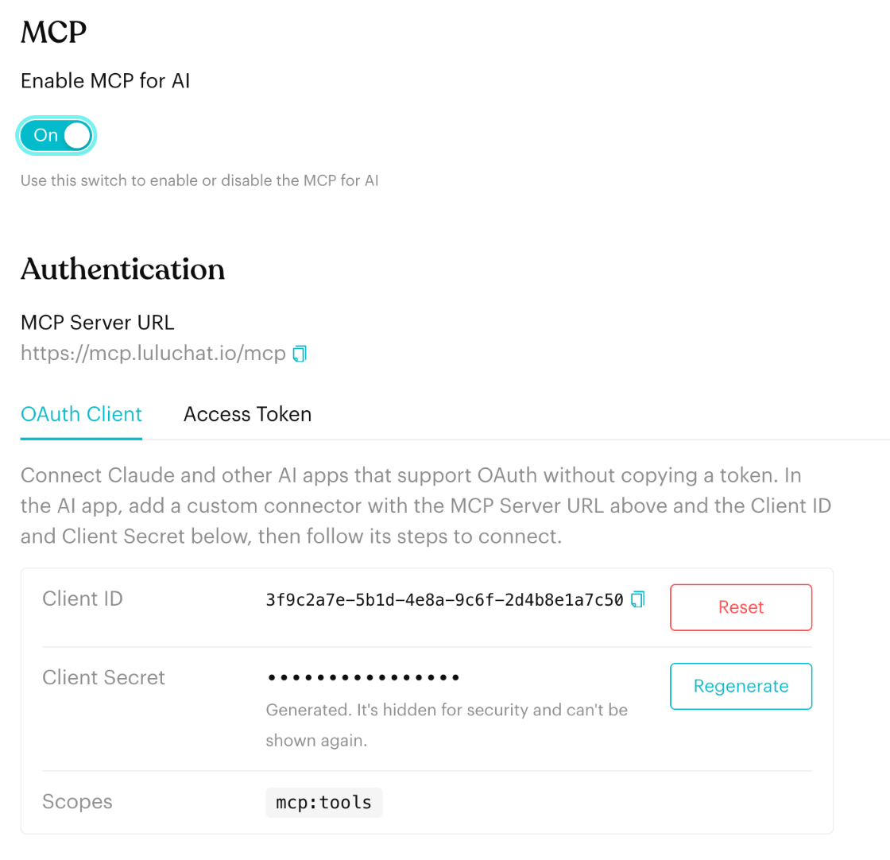
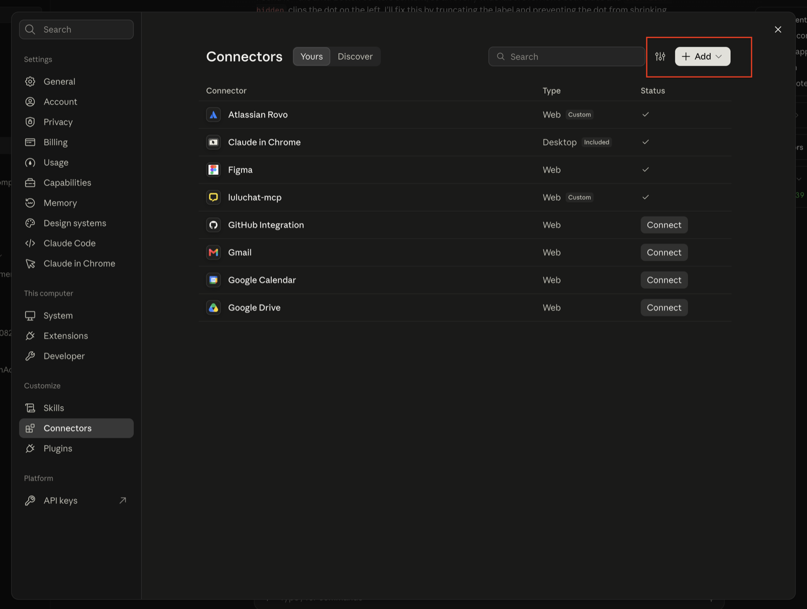
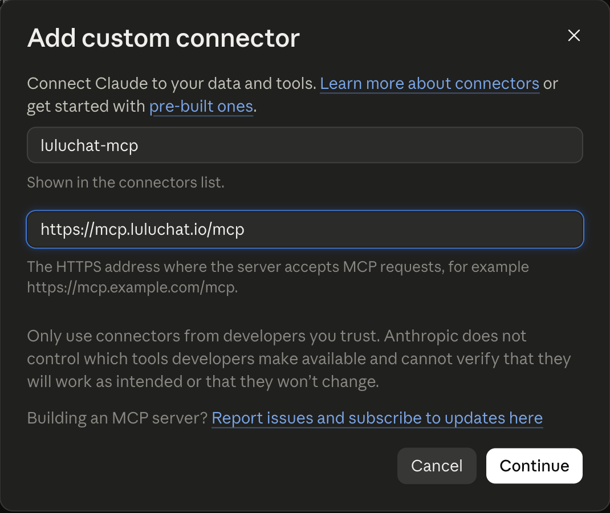
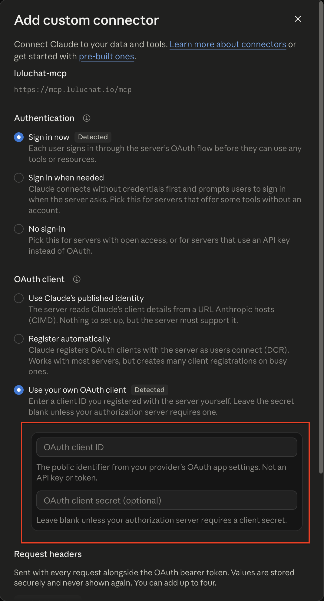
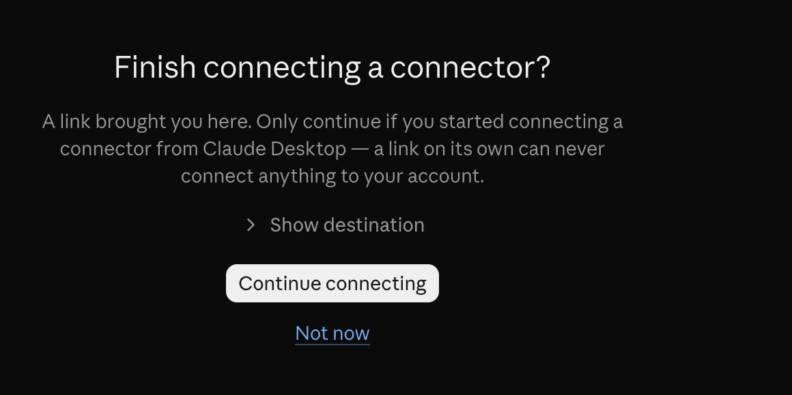
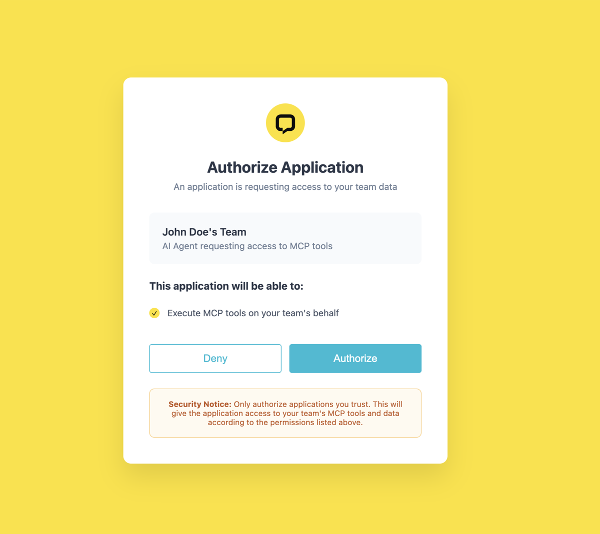

# Connect with OAuth

## What is it?

AI apps that support OAuth, such as Claude and Claude Code, can connect to Luluchat without you copying a token into the app. You give the app three things, then sign in and approve the connection in your browser:

| Item | Where to find it |
| --- | --- |
| **MCP Server URL** | `https://mcp.luluchat.io/mcp` |
| **Client ID** | `Settings` > `Tools` > `MCP` > **OAuth Client** |
| **Client Secret** | Generated in the same place. It's only shown once. |


If your AI app doesn't support OAuth, or you're connecting a script or server-side agent, use [Connect with an Access Token](connect.md) instead.


## When to use it?

* When you connect **Claude** (claude.ai or Claude Desktop) with a custom connector
* When you connect **Claude Code** in your terminal and want to sign in with your browser instead of pasting a token
* When any AI app asks for an **OAuth Client ID** and **Client Secret** for a remote MCP server
* When you'd rather not keep a long-lived access token inside an AI app

## How to set it up (Step by Step)



#### Turn on MCP

Go to `Settings` > `Tools` > `MCP` and turn **Enable MCP for AI** to **On**. Under **Tool Permissions**, turn on the tools you want the AI to use, then click **Save**. See [MCP Settings](../settings/tools/ai.md).



#### Copy the Client ID and generate a Client Secret

1. Under **Authentication**, stay on the **OAuth Client** tab
2. Copy the **MCP Server URL** and the **Client ID** with their copy icons
3. Click **Generate** next to **Client Secret** (it says **Regenerate** if a secret already exists)
4. Copy the secret from the **Client Secret Generated** window, then click **Done**

<figure><figcaption><p>OAuth Client</p></figcaption></figure>


The Client Secret is **only shown once**. If you lose it, click **Regenerate** to get a new one. Apps using the old secret will need to connect again.




#### Add Luluchat to your AI app

Add a custom connector (or remote MCP server) in your AI app with the MCP Server URL, Client ID and Client Secret. Then complete the sign-in and approval steps that open in your browser. Pick your app below.



## Connect your AI app



1. In Claude (claude.ai or Claude Desktop), open **Settings > Connectors**
2. Click **Add**, then **Add custom connector**

<figure><figcaption><p>Settings > Connectors > Add</p></figcaption></figure>

3. Enter a name, e.g. `Luluchat`, and the URL `https://mcp.luluchat.io/mcp`, then click **Continue**

<figure><figcaption><p>Name and MCP Server URL</p></figcaption></figure>

4. Under **Authentication**, keep **Sign in now**. Under **OAuth client**, choose **Use your own OAuth client** and paste your **Client ID** and **Client Secret**. Claude marks both options as **Detected** for Luluchat. Leave **Request headers** empty, then click **Add**

<figure><figcaption><p>Authentication and OAuth client</p></figcaption></figure>

5. If you use Claude Desktop, a browser page asks **Finish connecting a connector?**. Click **Continue connecting**

<figure><figcaption><p>Continue connecting</p></figcaption></figure>

6. On the Luluchat **Authorize Application** page, sign in if asked, check the team name is right and click **Authorize**

<figure><figcaption><p>Authorize Luluchat</p></figcaption></figure>

7. Back in Claude, Luluchat shows a tick under **Status** in the connectors list. Start a new chat, turn Luluchat on from the tools menu and send your first prompt (see [Test the connection](#test-the-connection))


The **Authorize** page connects the team you're signed in to in Luluchat. To connect a different team, switch teams in Luluchat first, then connect again.




Run this command in your terminal and replace `YOUR_CLIENT_ID` with your **Client ID**:

```bash
claude mcp add --transport http luluchat https://mcp.luluchat.io/mcp \
  --client-id YOUR_CLIENT_ID --client-secret
```

1. Claude Code asks for the **Client Secret**. Paste it and press Enter (it's hidden while you type)
2. Start Claude Code and type `/mcp`
3. Select **luluchat** and choose **Authenticate**
4. Sign in to Luluchat in the browser window that opens and approve the connection

Back in Claude Code, `/mcp` shows **luluchat** as connected.


* Add `--scope user` to the command to use Luluchat in every project on your computer. Without it, the connection only applies to the folder you ran the command in.
* The Client Secret can only be set when you add the server. If you regenerate it, run `claude mcp remove luluchat` and add the server again.
* For scripts or CI, put the secret in the `MCP_CLIENT_SECRET` environment variable instead of typing it at the prompt.




Any AI app that supports **remote MCP servers with OAuth** can connect. Look for a setting called *Custom connector*, *MCP Server* or *Integration*, and use:

* **Server URL**: `https://mcp.luluchat.io/mcp`
* **Client ID**: your **Client ID**
* **Client Secret**: your **Client Secret**

The app then opens a browser window for you to sign in and approve the connection.



## Test the connection

Start a new chat and ask your assistant something simple and read-only, for example:

> "Using Luluchat, show me all my team members."

The assistant should call the `get_team_staff` tool and list your team. If it does, you're connected! 🎉

A good second prompt is:

> "Which Luluchat channels do we have?"

This uses `get_channels` and shows each channel's UUID, which most other tools need. Next, browse the [Available Tools](tools/index.md) to see everything the assistant can do.

## Important behavior to know

* **Scopes**: The **Scopes** row shows what an OAuth connection may do. Which tools it can actually use still depends on **Tool Permissions**.
* **Regenerate**: Gives you a new Client Secret and disconnects every app connected with the old one. Access tokens keep working.
* **Reset**: Gives you a new Client ID, removes the Client Secret, and disconnects every OAuth app **and every access token**. Use it only if your credentials were leaked.
* **One workspace**: The Client ID belongs to your current team. The AI only sees that team's data.
* **Buttons apply right away**: **Generate**, **Regenerate** and **Reset** take effect as soon as you confirm. You don't need to click **Save**.

## Common issues & solutions

* **The app says the client secret is wrong**: The secret was regenerated or mistyped. Click **Regenerate**, copy the new secret and update the connector.
* **The connection stopped working**: Someone clicked **Regenerate** or **Reset**. Update the connector with the current Client ID and Client Secret and connect again.
* **The Client Secret shows as generated, but I never copied it**: Click **Regenerate** to get one you can copy.
* **Claude Code says it can't register the client or the OAuth flow fails before the browser opens**: Luluchat doesn't support automatic client registration. Make sure you added the server with `--client-id` and `--client-secret` as shown above.
* **Claude Code shows luluchat as needing authentication again**: Type `/mcp`, select **luluchat** and choose **Re-authenticate**. If the secret was regenerated, remove and add the server again first.
* **No tools at all**: Make sure **Enable MCP for AI** is on and at least one tool is turned on under **Tool Permissions**.

## Best practice 💡

* **Use OAuth for people, tokens for scripts**: OAuth suits AI apps people sign in to; access tokens suit server-side agents.
* **Keep the secret private**: Never paste the Client Secret into a chat, screenshot or shared document.
* **Regenerate, don't Reset**: If only the secret may have leaked, **Regenerate** is enough and keeps your access tokens working.
