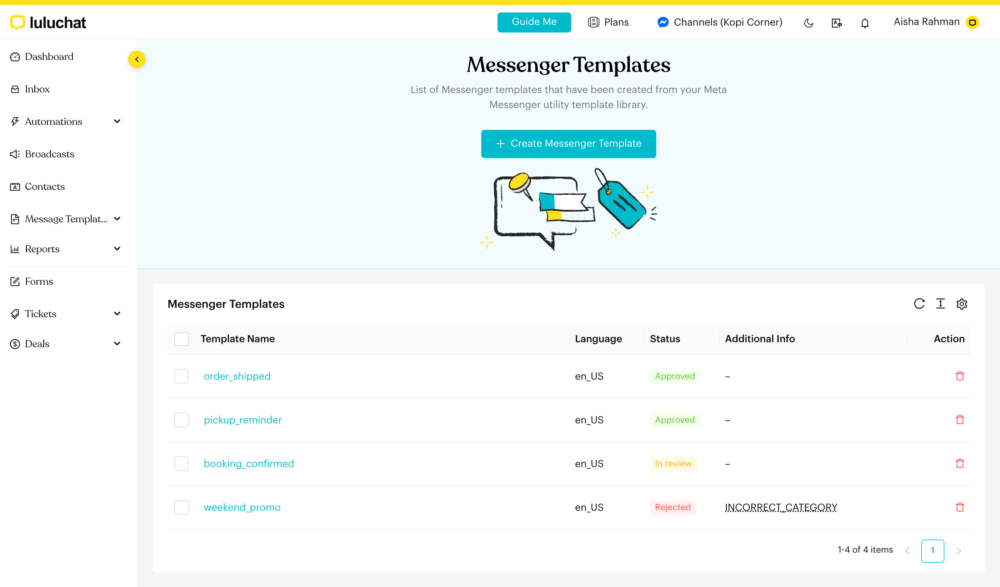
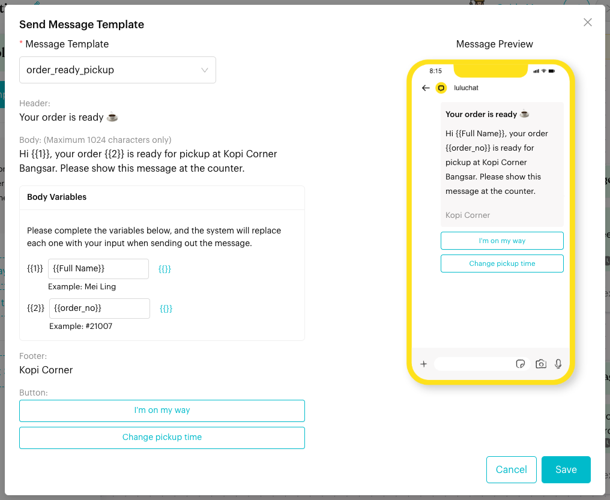

# Messenger Templates

## What are Messenger Templates?

**Messenger Templates** are pre-approved messages that let you reach a customer on a **Meta Messenger** channel **after the messaging window has closed**.

Meta only lets a business message a customer for a limited time after the customer's last message:

| Time since the customer's last message | What you can send |
| --- | --- |
| First 24 hours | Anything: agent replies, Message Flows, AI replies |
| 24 hours to 7 days | Replies from a real person only |
| After 7 days | **Only an approved Messenger Template** |

Every Messenger Template is reviewed by Meta, and Meta only approves the **Utility** category. That means **transactional updates** the customer is expecting:

* Order and delivery updates ("Your order #KC1024 has shipped")
* Account updates ("Your password was changed")
* Appointment, booking and event reminders ("Your table for 4 is confirmed for 7:30pm")

Greetings, promotions, discounts and other marketing are **rejected** with `INCORRECT_CATEGORY`.


Messenger Templates are only available on **Meta Messenger** channels. Instagram has no message templates. For WhatsApp Business API templates, see [Message Templates](message-templates.md).


## When to use it?

* A customer asked about an order more than 7 days ago, and it has just shipped.
* You want to remind a customer of a booking or pickup they made earlier.
* You want to send a Broadcast on Messenger. Broadcasts on Messenger can only send utility templates.
* A Message Flow needs to reach a customer after a long **Delay**.

## Where to find it

1. Make sure your current channel is a **Meta Messenger** channel (**Channels** button, top right).
2. In the left menu, click `Message Templates` > `Messenger Templates`.

The table lists every template on the connected Facebook Page:

* **Template Name**: Click a name to view the template (read-only).
* **Language**
* **Status**: **In review** (Meta is checking it), **Approved** (ready to send) or **Rejected**.
* **Additional Info**: Why Meta rejected it, for example `INCORRECT_CATEGORY`. Hover over it for a hint.
* **Action**: Delete the template. To delete several at once, tick them and click **Delete** at the bottom.

<figure><figcaption>
The Messenger Templates list
</figcaption></figure>

## How to create a template (Step by Step)



#### Open the form

Click **+ Create Messenger Template**.



#### Name, language and category

* **Template Name**: Up to 80 characters. Use lowercase words joined with `_`, for example `order_shipped`.
* **Language**: The language the template is written in.
* **Category**: Always **Utility**. It is set for you because Meta only offers Utility for Messenger templates.



#### Header (optional)

Choose **No header** or **Text header**. A text header is a short bold title of up to 80 characters, for example `Order {{1}} shipped`. It can have **one** variable.



#### Body

Write the message, up to 640 characters. Click **+ Add variable** to insert `{{1}}`, `{{2}}` and so on where the details change for each customer.

For each variable, fill in an example under **Body examples**. Meta uses the examples to review the template.

> Hi {{1}}, your order {{2}} is on its way and should arrive by {{3}}.
>
> Examples: `{{1}}` = Siti, `{{2}}` = #KC1024, `{{3}}` = 20 Nov



#### Buttons (optional)

Add up to **3** buttons. Each button has a **Button type** and a **Button label** (up to 20 characters). See [Choosing the right button](#choosing-the-right-button) below.



#### Click Create

Click **Create**. You will see "Template submitted. It may take a few moments for Meta to verify the template."

The new template appears as **In review**. The table refreshes on its own after a few seconds; you can also click the refresh icon. Most templates are approved within minutes, but some take longer.



## Choosing the right button

| Button type | What happens when the customer taps it | Use it for |
| --- | --- | --- |
| **URL** | Opens a web page | Tracking an order, viewing a receipt, managing a booking |
| **Phone number** | Calls your business | Urgent issues that need a person |
| **Postback** | Sends a reply back to Luluchat | Quick answers like "Confirm" or "Reschedule" that continue a flow |

### URL button

Opens a link in the customer's browser.

* **Same link for everyone**: Enter a fixed URL, for example `https://kopicorner.test/menu`.
* **Different link per customer**: End the URL with `{{1}}`, for example `https://kopicorner.test/orders/{{1}}`. Then fill in **URL suffix example** with a full sample link, such as `https://kopicorner.test/orders/KC1024`. When you send the template, you enter the part that replaces `{{1}}` (for example, the order number).

**Scenario: order shipped.** Kopi Corner ships an order 9 days after the customer last chatted. They send `order_shipped`:

> **Order #KC1024 shipped**
> Hi Siti, your order #KC1024 is on its way and should arrive by 20 Nov. Tap below to track it.
> \[ Track order \] → opens `https://kopicorner.test/orders/KC1024`

### Phone number button

Calls the number you set. Include the country code, for example `+60312345678`.

**Scenario: delivery problem.** A rider can't find the customer's address. Kopi Corner sends a `delivery_issue` template with a **Call the shop** button so the customer can phone the outlet straight away.

### Postback button

Sends the button label back to Luluchat as the customer's reply, so you see "I'm on my way" in the `Inbox`. Use it when you want an answer.

* **Payload (optional)**: A hidden ID sent with the tap, for example `ON_MY_WAY`. Leave it blank to use the button label.
* **In a Message Flow**, each Postback button can be linked to the next step, so the flow continues based on what the customer tapped.
* A Postback tap is a new message from the customer, so it **reopens the 24-hour window**. You can then follow up with normal messages, flows and AI replies.

**Scenario: pickup reminder.** Kopi Corner sends `pickup_reminder` from a Message Flow:

> Hi Siti, your order #KC1024 is ready for pickup at Kopi Corner Bangsar until 9pm today.
> \[ I'm on my way \] \[ Change pickup time \] \[ Call the shop \]

* **I'm on my way** (Postback) → the flow replies "See you soon! ☕" and tags the contact `pickup-confirmed`.
* **Change pickup time** (Postback) → the flow asks for a new time and assigns the chat to the outlet team.
* **Call the shop** (Phone number) → calls the outlet.

## How to use a template

### Send it from the Inbox

Open the chat and click **More Actions (⋮)** > **Messenger Template**. When the customer's last message is over 7 days old, the message box is replaced by a **Send Message Template** button. Pick the template, fill in its variables, check the preview and send it now or schedule it. See [Send a message template](inbox/send-messages.md#send-a-message-template-whatsapp-cloud-and-messenger).

### Send it from a Message Flow

Add a **Message Template** step and pick your Messenger Template. Fill in the variables with contact details, for example `{{Full Name}}`, then link each **Postback** button to the step that should run when it is tapped. See [Message Template node](automations/content-nodes/message-template.md).

<figure><figcaption>
Filling in template variables in a Message Flow
</figcaption></figure>

### Send it as a Broadcast

On a Messenger channel, a Broadcast must use a Message Flow whose **first step is a Message Template** with an approved utility template. Flows that start with a normal message fail for each recipient.

## Important behavior to know


**Important behavior to know**

* **Utility only**: Meta rejects anything that looks like marketing, even inside an order update ("...and get 20% off your next order!").
* **Only Approved templates can be sent**: Templates **In review** or **Rejected** can't be sent.
* **No editing**: You can view a template but not change it. To change one, create a new template and delete the old one.
* **Image headers**: Only text headers are supported for now.


## Common issues & solutions

* **I don't see Messenger Templates in the menu**:
  * Your current channel isn't a Meta Messenger channel. Switch channels from the **Channels** button.
* **"This page is only available for Meta Messenger channels"**:
  * Same as above: switch to your Messenger channel.
* **Rejected with `INCORRECT_CATEGORY`**:
  * Meta thinks the template is marketing. Remove greetings, offers and discounts, and keep it to a specific order, account or booking update.
* **My new template isn't in the list**:
  * Wait a few seconds and click the refresh icon.
* **"The header can only have 1 variable."**:
  * Move the extra details into the body.
* **The customer didn't get the template**:
  * Check it is **Approved**. Then check the chat for a failed message and its reason.

## Best practice 💡


**Best practice**

* Name templates after what they do (`order_shipped`, `pickup_reminder`) so your team can find them in flows.
* Use realistic examples for every variable: Meta reviews them.
* Add a **Postback** button when you want an answer. The tap reopens the 24-hour window, so you can continue the chat normally.
* Use a **URL** button with `{{1}}` for per-customer links like order tracking, instead of pasting long links into the body.


## Related Documentation

* [Meta Messenger](inbox/connect-messenger.md)
* [Send Messages](inbox/send-messages.md)
* [Message Template node](automations/content-nodes/message-template.md)
* [Broadcasts](broadcasts.md)
* [Message Templates (WhatsApp)](message-templates.md)
