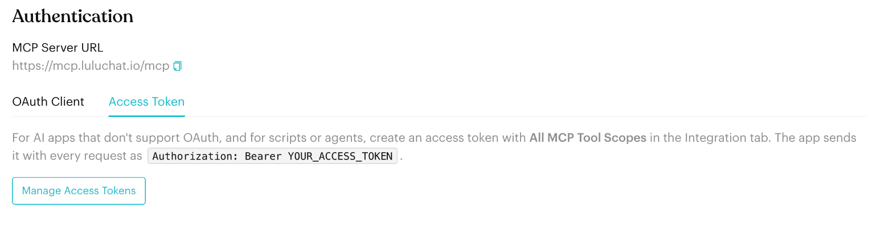
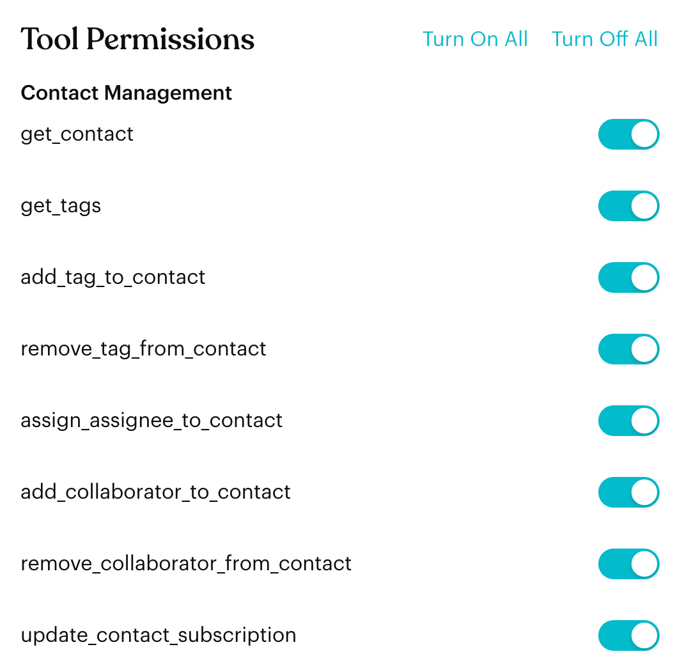

# MCP

## What is MCP Settings?

MCP Settings let AI apps and AI agents work with your Luluchat workspace through the **Model Context Protocol (MCP)**. Here you turn MCP on, get the details an AI app needs to connect, and choose which tools the AI may use.


This page used to be called **AI**. Old links to it still work. The screenshots on this page use sample data.


## When to use it?

* When you want an AI app such as Claude, ChatGPT or Cursor to read or update your Luluchat data
* When an **AI Agent node** in your Message Flows should use Luluchat tools
* When you need to change which tools the AI is allowed to use

## How to set it up (Step by Step)



#### Open MCP Settings

Go to `Settings` > `Tools` > `MCP`.



#### Turn on MCP

Turn **Enable MCP for AI** to **On**. The **Authentication** and **Tool Permissions** sections appear below it.



#### Connect an AI app

Under **Authentication**, copy the **MCP Server URL** (`https://mcp.luluchat.io/mcp`). Then pick how the AI app signs in:

* **OAuth Client** (recommended for Claude and other apps that support OAuth): use the **Client ID** and **Client Secret**. You don't need to paste a token into the app. See [Connect with OAuth](../../mcp/connect-oauth.md).
* **Access Token** (for apps without OAuth, scripts and agents): click **Manage Access Tokens** to create a token with **All MCP Tool Scopes** on the Integration page. See [Connect with an Access Token](../../mcp/connect.md).

<figure><figcaption>
Authentication: OAuth Client
</figcaption></figure>

<figure><figcaption>
Authentication: Access Token
</figcaption></figure>



#### Choose Tool Permissions

Under **Tool Permissions**, turn each tool on or off. Tools are grouped by feature (Contact Management, Inbox Tabs, Workspace Management, Deal, Ticketing, Forms and Booking). Use **Turn On All** or **Turn Off All** for quick changes, then click **Save**. See [Available Tools](../../mcp/tools/index.md) for what each tool does.

<figure><figcaption>
Tool Permissions
</figcaption></figure>



## What happens after it triggers?

Once MCP is on and an AI app is connected, the AI can "call" any tool you allowed to look up or change data in your workspace, for example finding a contact, adding a tag or creating a ticket. Tools that are turned off can't be used.

## Important behavior to know

* **Save to apply**: **Enable MCP for AI** and **Tool Permissions** only change after you click **Save**.
* **OAuth buttons apply right away**: **Generate**, **Regenerate** and **Reset** in the OAuth Client tab take effect as soon as you confirm. They don't wait for **Save**.
* **Client Secret is shown once**: After you click **Generate**, copy the Client Secret from the **Client Secret Generated** window. Luluchat only keeps a protected copy, so it can't show the secret again.
* **Regenerate disconnects OAuth apps**: AI apps connected with the old Client Secret are disconnected and need to connect again. Access tokens keep working.
* **Reset Client ID disconnects everything**: Reset creates a new Client ID and removes the Client Secret. Every app connected with OAuth, every access token and anything using the old Client ID stops working immediately.
* **One workspace**: The OAuth Client and access tokens belong to the current team. The AI only sees that team's data.
* **AI Agent nodes need Minicrew AI**: AI Agent nodes in Message Flows require a connected **Minicrew AI** integration. Praxus AI is no longer supported.


Only use **Reset** if you think your Client ID or Client Secret was leaked. To replace only the secret, use **Regenerate** instead.


## Common issues & solutions

* **The Authentication section is missing**: Turn **Enable MCP for AI** on. It only shows while MCP is on.
* **I lost the Client Secret**: Click **Regenerate**, copy the new secret, and update it in your AI app.
* **The AI app says a tool is not available**: That tool is turned off. Turn it on under **Tool Permissions** and click **Save**.
* **All access tokens stopped working**: Someone clicked **Reset** on the Client ID. Create new access tokens and reconnect your OAuth apps.

## Best practice 💡

* **Least privilege**: Only turn on the tools the AI actually needs.
* **Prefer OAuth for people**: Use the OAuth Client for AI apps a person uses, and access tokens for scripts and server-to-server agents.
* **Keep secrets private**: Never paste the Client Secret or an access token into a chat, screenshot or shared document.
