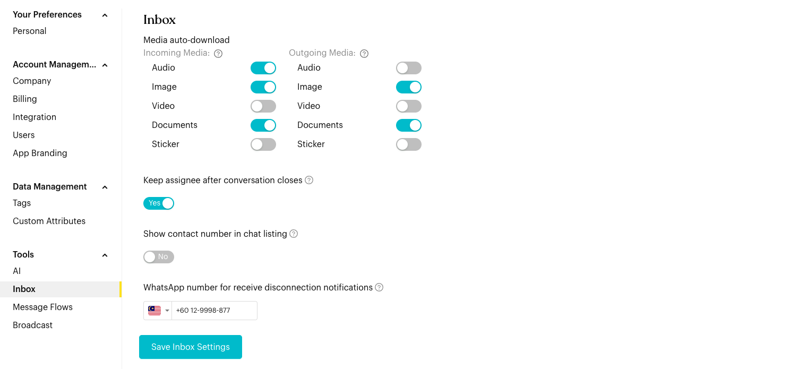
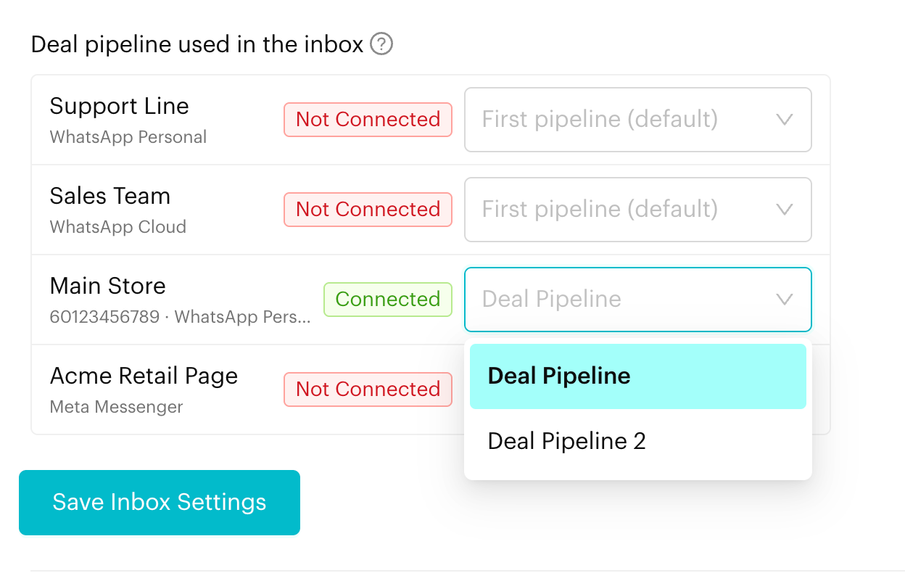
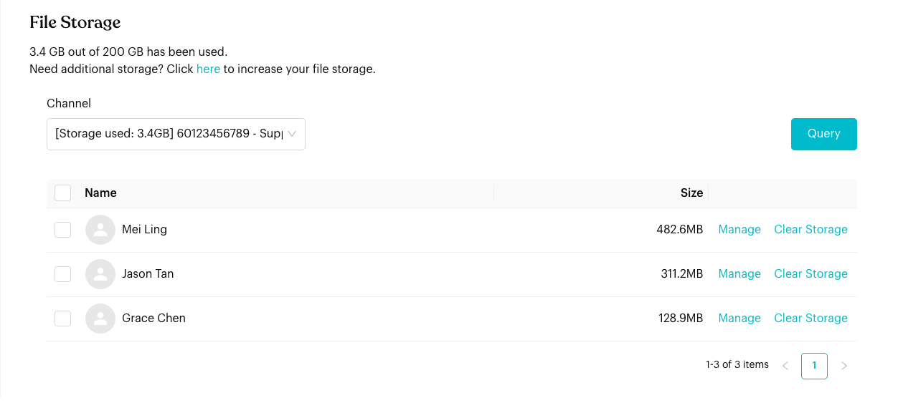

# Inbox

## What is Inbox Settings?

Configure media handling, conversation behavior, the deal pipeline used in the inbox, and manage file storage.

## How to set it up (Step by Step)



#### Configure Media Auto-download

Choose which media types are automatically downloaded when received or sent. This helps save bandwidth and storage.

* Incoming Media: Select Audio, Image, Video, Documents, or Stickers.
* Outgoing Media: Select which types you send that should be auto-processed.

<figure><figcaption>
Inbox settings
</figcaption></figure>



#### Set Conversation Behavior

* Keep assignee after conversation closes: Toggle "Yes" to ensure the same teammate remains owner even after a thread is resolved.
* Show contact number in chat listing: Toggle "Yes" to always display the phone number next to the contact name in your inbox list.
* WhatsApp number for receive disconnection notifications: Enter a WhatsApp number to be alerted when a channel disconnects.



#### Choose the Deal Pipeline for Each Channel

Under **Deal pipeline used in the inbox**, every channel in your team has its own row. Pick the pipeline the inbox should use for that channel. Each channel has its own deal pipelines, so you choose one per channel.

The chosen pipeline is used in the [Inbox](../../inbox/contact-info/deals.md) for that channel:

* **Create a Deal** in the conversation header, and **Create** or **Create a Deal** in Contact Info, start the new deal in this pipeline, at its first stage.
* The conversation header shows the contact's newest deal in this pipeline first.

Leave a row on **First pipeline (default)** to keep using the channel's first pipeline. To go back to the default, clear the selection with the **×** in the field.

Click **Save Inbox Settings** to apply your changes.

<figure><figcaption>
Deal pipeline used in the inbox
</figcaption></figure>


This list only appears when your plan includes Deals and your team has at least one channel. The pipeline list for a channel loads when you open its dropdown.




#### Monitor File Storage

View your current storage usage at the bottom.

* Example: "0.5 GB out of 120 GB has been used."
* Note: If you run out of space, click the link to view subscription upgrade options.

<figure><figcaption>
File Storage
</figcaption></figure>



#### Manage Storage Space

Choose a **Channel** and click **Query** to see which contacts use the most space in that channel.

* Manage: Opens the media library for that specific contact.
* Clear Storage: Permanently deletes all media files for that contact to free up space.



## Important behavior to know

* **Storage Deletion**: "Clear Storage" is permanent. You cannot recover media files once they are deleted from the platform.
* **User Preference**: These settings affect how the inbox behaves for all team members in this workspace.
* **Deleted pipeline**: If the pipeline chosen for a channel is deleted, the inbox goes back to the channel's first pipeline, and the row shows **First pipeline (default)** again.
* **Existing deals**: The setting only decides where new deals start and which deal the header shows first. Existing deals stay in their own pipeline, and you can still pick any pipeline in the **Create a Deal** window.

## Common issues & solutions

* **The Deal pipeline list is missing**: Your plan does not include Deals, or your team has no channels yet.
* **"No deal pipelines in this channel"**: That channel has no deal pipelines yet. Switch to the channel and create one in [Deals](../../deals/board.md).
* **The inbox still uses the old pipeline**: Make sure you clicked **Save Inbox Settings**, then reload the inbox.

## Best practice 💡

* **Selective Auto-download**: Disable auto-download for large Video files if you primarily use Luluchat for text and images.
* **Regular Cleanup**: Periodically clear storage for old or inactive contacts to stay within your plan limits.
* **One pipeline per team**: If a channel is used by one team (for example sales or support), choose that team's pipeline so deals created from chats land on the right board.
